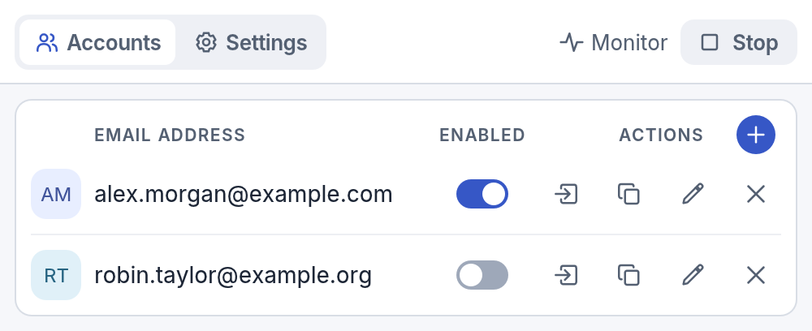

#  Windows App AutoLogin

Windows App AutoLogin fills the password prompt when you reconnect to a work desktop in Microsoft Windows App. It runs in the macOS menu bar or Windows system tray. You choose which accounts it can use and can pause autofill with **Stop Monitor**.

## How your password is protected

### Where passwords are stored

AutoLogin stores passwords in **macOS Keychain** or **Windows Credential Manager** by default. On Windows, DPAPI ties each new credential to your Windows user. Account emails, desktop links and preferences are saved separately in the local settings file.

If you choose encrypted file storage, AutoLogin encrypts each password with AES-256-GCM and generates a fresh key each time you save it. The key stays in the system credential store, so a copy of the file alone is insufficient to read the passwords.

### Which window can receive a password

1. **Verify the client.** AutoLogin checks the running application's Microsoft signature and installation path, and locates its foreground credential prompt.
2. **Match the account.** The email shown in the prompt must match exactly one enabled account. Only then does AutoLogin retrieve that account's password. If the email is missing or ambiguous, the prompt stays open for you.
3. **Verify the field.** Just before entry, AutoLogin rechecks the prompt and the field identified as secure by the operating system. It sends the password directly to the Microsoft client, keeping it out of the clipboard and diagnostic reports.

These checks run on your computer. The Microsoft client handles authentication. [Credential storage implementation](src/storage/mod.rs) · [Autofill checks](src/debug_fill.rs)

## Get started

| Platform | Download | Install |
| --- | --- | --- |
| macOS 11+, Apple Silicon | [macOS v1.0.3](https://github.com/obcardinal/Windows-App-AutoLogin/releases/tag/v1.0.3) | Extract the ZIP and move `Windows App AutoLogin.app` to `/Applications`. Install Microsoft's client at `/Applications/Windows App.app`. |
| Windows 10/11, x64 | [Windows v0.4.0](https://github.com/obcardinal/Windows-App-AutoLogin/releases/tag/v0.4.0) | Extract the ZIP and run `WindowsAppAutoLogin.exe`. Keep `WindowsAppAutoLoginUI.exe` in the same folder. Both executables are unsigned. |

1. Open AutoLogin. On macOS, grant it **Accessibility** under **System Settings → Privacy & Security** so it can read and fill the sign-in prompt.
2. In **Accounts**, click **Add Account** for your first account. To add another, click **+** in the table header. Save the email that Windows App shows at sign-in and the password for that account.
3. If monitoring is paused, choose **Start Monitor**. Open the remote desktop and leave its sign-in prompt in front. Enable **Settings → System → Open at Login** if you want AutoLogin to start with your computer.

On macOS, right-click the menu bar icon and choose **Check for Updates…** to get future releases. If you use v0.4.1 or earlier, install the latest macOS ZIP once to enable this option. When installing the ZIP over a copy named `WindowsAppAutoLogin.app`, quit the app and rename that copy to `Windows App AutoLogin.app` in Applications so Finder can replace it.

The Windows version also recognizes Microsoft Remote Desktop and the built-in Remote Desktop Connection client.

## Linked desktops and two-factor sign-in on macOS

When a new remote desktop connects, AutoLogin closes the Windows App device list. Your desktop stays open, and you can reopen the list at any time. To keep the list open after every connection, turn off **Settings → Windows App → Close device list after connecting**.

### Reconnect to a locked desktop

Choose the desktop under **Connection → VM device** in the account editor. With multiple accounts, use **Import** to match the Remote PC address to the account. With one account, the address is optional.

**Reconnect when locked** is on by default for linked desktops on macOS 14+. It uses **Screen Recording** to recognize the English Windows password screen in the foreground VM window. The image is processed in memory on your Mac and discarded. Recognition triggers a reconnect. Password entry takes place in Windows App's verified credential prompt.

### Confirm a sign-in on your iPhone

In **Settings → 2FA → Devices → Connect iPhone…**, choose your phone and click **Connect iPhone**. AutoLogin checks the Wi-Fi connection and remembers that iPhone for your accounts. For first-time pairing, click **Open device pairing…** and follow Apple’s prompts. Connecting requires Xcode but no signing certificate.

Open **Sign-in details… → Set up automation…** to prepare UI Automation. The setup screen guides you through Developer Mode, Enable UI Automation and adding your own Apple Account in Xcode. Choose your signing account and click **Set up automation**. AutoLogin installs the required tools, signs the helper for your iPhone and checks that it can run over Wi-Fi.

Turn on **2FA → Use iPhone** for each participating account. AutoLogin enters the number from Windows App in Microsoft Authenticator. Complete Face ID on the phone if prompted. [iPhone setup and requirements](docs/iphone-authenticator.md#host-setup)

**Optional Telegram reminder.** Select **Settings → 2FA → Notifications → Link Telegram…** and tap **Start** in the bot chat. Only a matching two-factor request triggers a reminder, which can wake the phone if lock-screen notifications are enabled. The notification service sees when a reminder is requested and uses a link token to reach your chat. The request excludes your work email, password, sign-in number and screen contents.

## Development

Use Rust 1.93 or later. On macOS, `./script/build_and_run.sh` builds and opens the local app. On Windows, run `.\script\build_windows_dist.ps1 -Development` from a clean checkout in x64 Visual Studio Developer PowerShell. Run the Rust tests with `cargo test --locked`.

Independent open-source project. [MIT license](LICENSE)
